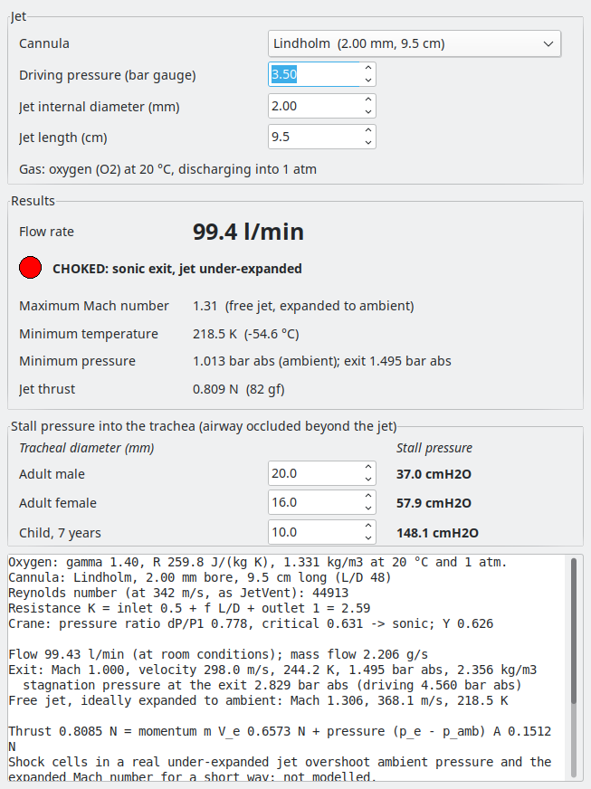

# anaesthesia-sims

Anaesthesia, respiratory and clinical-physiology simulations and demos,
written in Free Pascal / Lazarus on top of
[newVM](https://github.com/howarddent/newVM), a matrix/vector library
wrapping MKL, IPP, OpenBLAS, FFTW and (where available) OpenCL and Metal.

These projects used to live inside the newVM repository. They were moved
here, with their git history, so that newVM stays a general-purpose
library.

## Contents

| Project | What it does |
|---|---|
| `Anaesthetics/PK-PD_FPC` | Pharmacokinetic/pharmacodynamic simulator: plasma and effect-site concentrations of propofol, remifentanil and seven other agents under various infusion regimens (three-compartment model), with FPCUnit tests. `Anaesthetics/PK-PD` is the original Delphi/MtxVec version. |
| `demos/JetVent` | Jet-ventilation cannula calculator: six cannulae, bench measurements against a Darcy-Weisbach/Crane flow model, Mach number and exit state. |
| `demos/JetFlow` | Jet-flow calculator built on JetVent's model: flow, choking, the lowest temperature and pressure in the jet, thrust and tracheal stall pressure. |
| `demos/O2Entrainment` | Delivered O2 % against the entrainment ratio, with Venturi valve ratings. |
| `demos/BioSpectra` | Spectra of ECG, EEG, arterial pressure and anaesthesia EEG (VitalDB), plus EEG bispectrum and bicoherence. |
| `demos/GlassSpine` | Spinal anaesthesia in real time: hyperbaric and plain bupivacaine spreading through a transparent dural sac under gravity, with CSF pulsation, on the GPU (OpenCL). |
| `FEM4/Examples/ThermEx1` | Core temperature of an anaesthetised adult losing heat in a cold theatre. |
| `FEM4/Examples/Defibrillation` | Current spread from a 200 J defibrillator shock through a torso. |
| `FEM4/Examples/HFJV` | High-frequency jet ventilation in a supine adult: lumped thorax and FEM abdomen, in the frequency and time domains. |
| `FEM4/Examples/LeftVentricle` | Finite-element left ventricle with Hill-type fibres and lumped valves: pressure-volume loop, wall motion and twist, with an OpenGL viewer. |
| `FEM4/Examples/Aorta` | Arterial pulse waves from the aortic valve to the femoral arteries and the left wrist (1-D finite elements, viscoelastic wall), driven by the ventricle model, with an OpenGL viewer. |
| `FEM4/Examples/circ_sim` | The ventricle and the arterial pulse together: wall motion and pressure-volume loop on one tab, the aortic pulse on another, computed in one step. |

`CLAUDE.md` has the detailed notes on each one: models, assumptions,
verification and results.

## Getting it

newVM is a git submodule, so clone recursively:

```
git clone --recursive https://github.com/howarddent/anaesthesia-sims.git
```

(or run `git submodule update --init` after a plain clone).

## Building

Set up newVM first, as its README describes: install whichever
acceleration libraries the machine has, then run `newvmconfigure` inside
`newVM/` to generate `newVM/newVMConfig.inc`. Then build any project with
`lazbuild`, e.g.:

```
lazbuild --ws=gtk2 demos/JetVent/JetVent.lpi
```

The console programs (GlassSpine's `spinecheck`, HFJV's `hfjvrun`) are
built with plain `fpc`; their command lines are in each program's header.
GlassSpine needs OpenCL with clFFT. The FEM4 examples use the FEM4 framework
in `newVM/Delphi OOFEM/`, and gmsh at run time.

## Screenshot

`JetFlow`: here the Lindholm (2 mm, 9.5 cm) at 3.5 bar is choked, and its
jet expands to Mach 1.31 at −55 °C outside the cannula:



## Caveat

These are research and teaching models, not medical devices. They must
not be used to guide the care of any patient.

## Licence

Copyright (C) 2026 Howard Dent.

This is free software: you can redistribute it and/or modify it under the
terms of the GNU General Public License as published by the Free Software
Foundation, either version 3 of the License, or (at your option) any later
version. It is distributed in the hope that it will be useful, but WITHOUT
ANY WARRANTY; without even the implied warranty of MERCHANTABILITY or
FITNESS FOR A PARTICULAR PURPOSE. See [`LICENSE`](LICENSE) for the full
text.

Third-party material here keeps its own licence: `demos/JetVent/naca1135.pas`
and `rayfanno.pas` (public domain); `Anaesthetics/PK-PD/ut_dgls.pas`
(J-P Moreau) and its DMath-derived `ubisect`/`usecant`/`uerrors`; the
Kaps-Rentrop integrators ported from *Numerical Recipes*
(`Anaesthetics/PK-PD/kaps_Rentrop.PAS`,
`Anaesthetics/PK-PD_FPC/uKapsRentrop.pas`), on Numerical Recipes' own
terms; and the recorded data under `demos/BioSpectra/data/` (see its
`README.md` for sources and terms).
